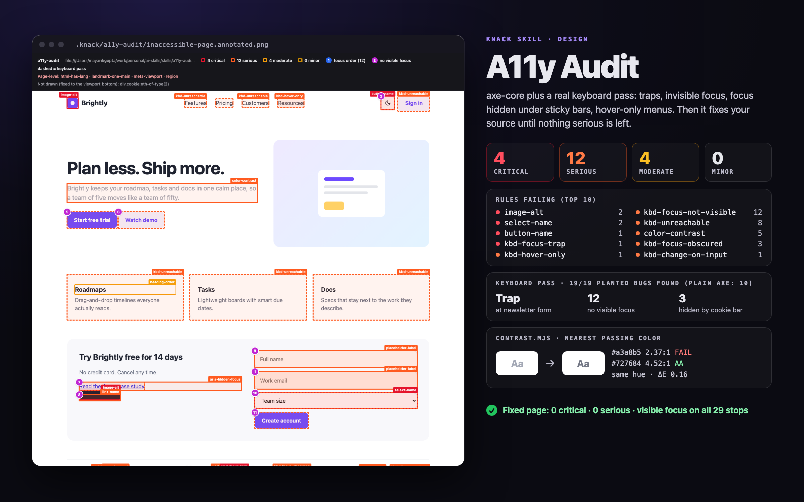

# A11y Audit

> Runs axe-core and a real keyboard pass, shows the agent what's broken, and keeps it fixing source until the page passes.



Generated UIs look fine and are often unusable with a keyboard or a screen reader: clickable `<div>`s, `outline: none`, placeholder-only inputs, grey-on-white text. Most accessibility skills just give the agent a list of guidelines. This one **runs real tools**, shows the agent what it found, and keeps it fixing source until the page passes.

## What it does

1. **axe-core audit**: injects axe-core 4.13 into the page with Playwright (lazy iframes loaded first) and runs the WCAG 2.0/2.1/2.2 A + AA and best-practice rules.
2. **Keyboard pass** (things axe can't check): presses Tab through the page for real and records:
   - focus order (numbered on the screenshot), focus traps and which elements they make unreachable
   - controls with **no visible focus indicator** (screenshot before vs. after focus, pixel diff; also finds rings drawn on a card, a label, or a sibling)
   - focus **removed by a script** (`onfocus="blur()"`), and focus **hidden under a sticky header or cookie bar** (WCAG 2.2 SC 2.4.11)
   - **clickable elements keyboard users can't reach** (cursor:pointer, `onclick`, interactive roles, real click listeners)
   - **menus that open on hover but not from the keyboard**
   - `<select>`s that **navigate as soon as they change** (3.2.2; the navigation is blocked, nothing new loads)
   - with `--state` on a modal: does **Escape** close it, and does focus **return to the trigger**
   - focus landing on invisible elements, positive `tabindex`, focus jumping backwards on screen
3. **Report**: `report.md` opens with a prioritized "Fix first" list, groups identical markup, gives each rule the WCAG criteria, a fix, a note for your stack when it detects one (Next/React, Vue/Nuxt, Svelte, Angular, Astro, Tailwind, MUI, Radix), and an `rg` command to find the element in source; `report.json` for tooling; an **annotated screenshot** per page, sliced into readable parts on long pages.
4. **Fix loop**: the agent maps each finding to your components, fixes them semantic HTML first, re-runs until there are zero critical/serious issues, then tells you what still needs a human.
5. **Contrast helper**: `contrast.mjs` gives the WCAG ratio (truncated, never rounded up), AA/AAA pass/fail, and the **nearest passing color with the same hue**.

## Example prompts

- "Audit my app for accessibility"
- "Is this page WCAG AA compliant? http://localhost:3000/pricing"
- "Fix the contrast issues on the landing page"
- "Make the nav and modal keyboard accessible"
- "Check the signup form with a screen reader in mind"
- "Run an a11y check on dist/index.html and fail if anything serious is left"

## Requirements

- Node.js 18+
- Run `bash scripts/setup.sh` once. It installs Playwright 1.63.0, axe-core 4.13.0, and Chromium (~150 MB). If Chromium can't be downloaded, an installed Chrome or Edge is used.
- A running dev server or a local `.html` file. No network calls except loading the page under test, no telemetry.

## Try it

```bash
bash scripts/setup.sh
node scripts/audit.mjs examples/inaccessible-page.html     # 19 planted bugs, all found (plain axe finds 10)
node scripts/audit.mjs examples/accessible-page.html       # same page, fixed: 0 issues
node scripts/contrast.mjs "#777" "#fff"
```

## Sample output

```text
◆ Auditing file:///…/examples/inaccessible-page.html (1280×800)
◆   axe-core 4.13.0: 12 rule violation(s), 1 need review
◆   keyboard: 14 focus stops, TRAP at #news-name; 12 without visible focus; 8 clickable-but-unreachable
◆   issues by impact: 4 critical · 12 serious · 4 moderate · 0 minor
◆ Report → .knack/a11y-audit/report.md
◆ JSON   → .knack/a11y-audit/report.json
◆ Image  → .knack/a11y-audit/inaccessible-page.annotated.png
```

```text
$ node scripts/contrast.mjs "#a3a8b5" "#fff"
#a3a8b5 on #ffffff  →  2.37:1
  FAIL  AA                     needs 4.5:1
  FAIL  AAA                    needs 7:1
  FAIL  UI / large-text (3:1)  needs 3:1

  Nearest fg for 4.5:1 (same hue; ΔE = OKLab distance, 0.02 ≈ just noticeable):
    #727684  4.52:1  darker  ΔE 0.164  oklch(56.7% 0.022 273.0)
```

`report.md` excerpt:

```markdown
### `kbd-focus-obscured`: Focused element is entirely hidden behind a sticky or fixed element
3 element(s) · keyboard pass · WCAG 2.4.11 Focus Not Obscured (Minimum)
**How to fix:** Reserve room for the sticky/fixed layer: html { scroll-padding-top: …; scroll-padding-bottom: … } …
- `#news-name`
  - `<input id="news-name" placeholder="Name">`
  - When focused, this element is entirely covered by the fixed/sticky element `div.cookie:nth-of-type(2)`.
  - find in source: `rg -n -F "news-name"`
```

## How well it works

Measured in October 2026 against public pages (re-run the same commands to reproduce):

- **Recall, W3C "Before and After" demo** ([BAD](https://www.w3.org/WAI/demos/bad/)): on the four inaccessible pages, of the 59 issues W3C documents (page annotations plus the evaluation reports), plain axe-core 4.13 finds 18 and this skill finds 26. The extra 8 are behavior axe does not test: links that throw focus away (F55) and the "quick menu" that navigates on change (3.2.2). Most of what neither finds needs judgment (alt text quality, reading order, fake headings, lists and tables), which is exactly the part left for a human.
- **Precision, accessible sites**: GOV.UK (3 pages), the GOV.UK Design System (10 pages, including custom checkboxes and radios), and W3C WAI (4 pages incl. an APG modal): **no** findings from the keyboard pass or placeholder check. Earlier versions raised false alarms here (custom checkboxes reported as invisible, an iframe "without focus", a back-to-top link "jumping"); those are fixed.
- **Contrast**: ratios match the [WebAIM checker](https://webaim.org/resources/contrastchecker/) on 13 of 13 pairs (to the digits WebAIM shows), alpha compositing matches axe-core, and every suggested color re-checked on WebAIM passes. Against an exhaustive search of all 16.7M sRGB colors, the suggestion is within 5% of the true nearest passing color in OKLab for chromatic colors; for grays it stays neutral (at most 0.002 ΔE further, far below what anyone can see).

## Files

| Path | What |
|---|---|
| `SKILL.md` | The workflow the agent follows |
| `scripts/audit.mjs` | axe-core + keyboard pass + annotated screenshot + reports |
| `scripts/contrast.mjs` | Contrast ratio and nearest passing color |
| `references/fix-recipes.md` | Before/after fixes (HTML, JSX, Tailwind) for ~35 rules, including every keyboard-pass rule |
| `references/manual-checks.md` | The checks no tool can do: screen reader, zoom/reflow, motion, captions |
| `examples/` | A page with planted issues and its fixed twin |

## Honest limits

Automated testing finds only part of the barriers: in GDS's test page with 142 known barriers, the best tool found 40% and axe 29% ([GDS audit](https://alphagov.github.io/accessibility-tool-audit/)); Deque reports 57% when counting by issue volume ([Deque](https://www.deque.com/blog/automated-testing-study-identifies-57-percent-of-digital-accessibility-issues)). This skill tests more behavior than axe alone, but it can't judge whether alt text or link text is meaningful, whether reading order makes sense, or whether captions are accurate, and a clean report is not a WCAG conformance claim. It Tabs forwards only (check Shift+Tab under sticky headers yourself), runs Chromium only, and does not measure focus visibility inside iframes. The agent ends every run with a short manual checklist for you, and it will never suggest an overlay widget as a fix.

## License

MIT
