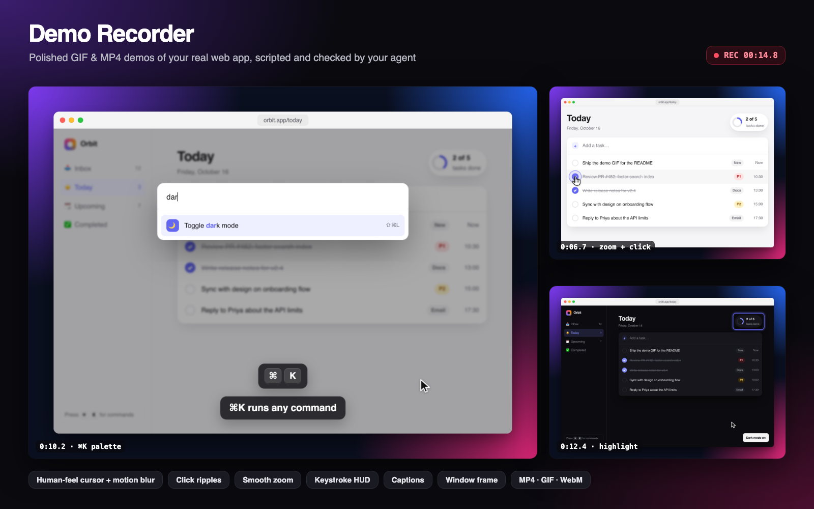

# Demo Recorder

> Polished GIF and MP4 demos of your real, running app, with a smooth cursor and captions, scripted and checked by your agent.

Ask your agent for "a GIF of the signup flow for the README" and get a crisp, smooth clip of
your **real, running app**: an eased cursor that glides to each button, click ripples,
keystrokes shown on screen, optional zoom and captions, wrapped in a tidy window frame.



## Why

Screen-recording a feature by hand means re-takes, a jittery mouse, a messy desktop and a
40 MB GIF. Tools like Remotion make authored videos; they do not record your actual app.
This skill lets the agent script the flow, check every step, record, and review the result
itself before handing you a file that fits GitHub's limits.

- **Retina-sharp and smooth.** Time is virtualised, so every frame is captured at 2x with
  exact timing, even on a slow machine. No dropped frames, no soft VP8 blur.
- **A cursor people can follow.** Headless browsers have no cursor; the recorder draws one
  at a legible size with a human velocity profile (minimum-jerk, gentle landing), motion
  blur while it travels, hand/I-beam shapes, press feedback and ripples.
- **Calm, framed zooms.** Zoom fits the target, scales straight in about a fixed point (no
  sideways slide) and settles softly. `--no-zoom` gives a reduced-motion take.
- **Self-checking.** A dry run screenshots every step; failures list similar elements with
  ready-to-paste selectors; every recording ends with a contact sheet the agent reads.
- **Built for where demos go.** MP4/WebM with BT.709 colour tags so brand colours match
  the page (mean ΔE 0.3 in Chrome, was 5.6), GIF with a full-clip palette (no speckled
  chrome or banded gradients), size warnings at 10 MB, a legibility estimate at README and
  phone width. Idle-trimming, speed-up and length caps included.

## Example prompts

- "Record a GIF of the signup flow for the README."
- "Make a short MP4 showing the new ⌘K command palette for our changelog post on X."
- "Add a before/after clip of the settings page fix to this PR."
- "Capture a walkthrough of creating and sharing a dashboard, with captions, in dark mode."
- "Re-record docs/demos/invoice.flow.json, the button labels changed."

## Try it

```bash
cd skills/demo-recorder
bash scripts/setup.sh                          # Playwright + Chromium, checks ffmpeg
node scripts/record.mjs examples/flow.json     # records the bundled Orbit demo app
```

You get `.knack/demo-recorder/orbit-demo.mp4`, `orbit-demo.gif` and `orbit-demo-sheet.png`
(a 15-second clip: typing a task, zooming in to complete one, opening the ⌘K palette and
switching to dark mode). About 30 seconds on an M-series Mac; MP4 ≈ 1.3 MB, GIF ≈ 2.1 MB.

Other entry points:

```bash
node scripts/record.mjs examples/flow.json --dry-run     # per-step screenshots, no video
node scripts/inspect.mjs --find-server                   # which localhost ports are serving
node scripts/inspect.mjs http://localhost:3000           # selectors + annotated screenshot
node scripts/record.mjs --help                           # every flag
```

## How a flow looks

```json
{
  "url": "http://localhost:3000",
  "viewport": "1024x680",
  "format": ["gif", "mp4"],
  "frame": true,
  "steps": [
    { "click": "role=button[name=\"New project\"]" },
    { "type": "Q4 launch plan", "into": "#project-name" },
    { "press": "Enter" },
    { "wait": "text=Project created" },
    { "highlight": ".project-card", "duration": 1200 }
  ]
}
```

Full reference: [references/flow-format.md](references/flow-format.md).

## Requirements

- Node.js 18+
- ffmpeg (`brew install ffmpeg`, `apt-get install ffmpeg`, `winget install Gyan.FFmpeg`)
- Chromium via Playwright (installed by `setup.sh`; falls back to installed Chrome or Edge)
- A running web app (any framework, or a static HTML file)

No network calls beyond loading the page you record. Output stays in `./.knack/demo-recorder/`.

## Limitations

- Pages driven by `<video>` or real-time WebGL can misbehave under virtual time; use
  `--realtime` for those.
- Native `<select>` menus, browser dialogs and file pickers are not drawn.
- Chromium only; one tab per recording.
