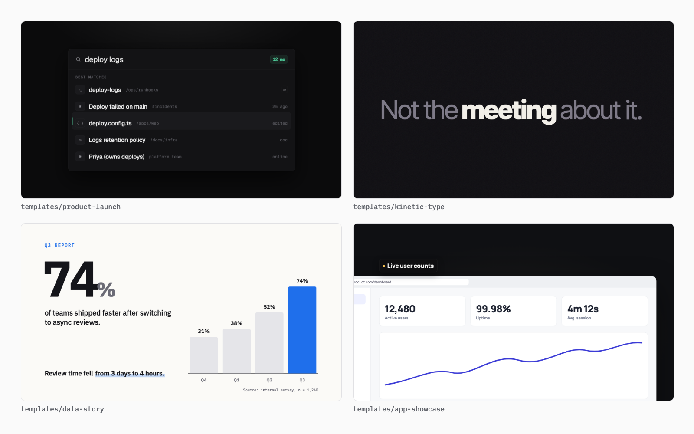

# Motion Video

> Brief or "go all out" → shot list → code → a scored, frame-accurate video. Your agent becomes a motion designer and director that checks its own frames.



**Motion Video** makes real MP4s, with synced sound, from one line:
- open creative briefs such as the viral *"make a dynamic 15-second motion graphics video that shows what an incredible motion designer you are… go all out"*
- concrete jobs: launch videos, logo stings, kinetic type, data stories, app showcases and vertical social clips

Each video is plain HTML, CSS and canvas on a tiny deterministic timeline. Playwright captures every frame and ffmpeg encodes them, and a built-in synthesizer scores the picture: music on the beat grid, plus whooshes, hits and risers placed on every cut.

**Tested on Claude Opus 5.5.** The skill pins `model: claude-opus-5-5` with `effort: xhigh`. Other models are untested, and the instructions are tuned to how Opus 5.5 plans, critiques and iterates.

## Two modes

| Mode | Triggered by | Behaviour |
|---|---|---|
| **Creative freedom** | "go all out", "showreel", "impress me", "show what you can do" | No questions, no approval gate. It picks a concept with a single visual thread, an art direction, a BPM and 5–7 shots that each show a different technique. It builds them with match cuts and floods, scores the result, and reviews it against a reel rubric |
| **Brief** | A product, feature, logo, stat or message | Asks up to 3 questions, gets your 👍 on a storyboard, then follows your brand |

The creative mode is built to avoid the reel everyone gets from that prompt (dark background, neon accent, "MOTION / PRINCIPLES", particles spelling a name, a grain-and-timecode HUD). See [`references/showreel.md`](references/showreel.md).

## Why it's different

| Aspect | Motion Video | Prompting an agent to "make a video" |
|---|---|---|
| Plans first | A beat-grid shot list with a concept, palette and sound cues | Jumps straight to code |
| Sound | Synthesized score and sound effects synced to every cut, mixed to -14 LUFS | Silent, or a separate tool |
| Sees its output | Reads **filmstrips** and stills at every cut, then fixes what it finds | Can't watch video, so ships blind |
| Lints itself | `--check` flags off-frame, overlapping or tiny text, unloaded fonts, cut-off animations and empty poster frames | Not available |
| Craft built in | Concept seeds, a technique palette with code, editing rules, a reel rubric, timing tables and safe zones | Generic tweens |
| Zero lock-in | One HTML file plus a small MIT runtime: no framework, no license fees | Not applicable |

## Example prompts

- "Make a dynamic 15-second motion graphics video that shows what an incredible motion designer you are, like it's your showreel for a résumé. Go all out."
- "Make a 12-second launch video for our v2 release. Use the colors from our Tailwind config."
- "Create a 4-second logo sting from `public/logo.svg` at 60fps."
- "Turn these three stats into an animated data story for LinkedIn (4:5)."
- "Make a vertical Reel with 3 CSS tips, safe zones respected."
- "Render a transparent lower-third with my name for a YouTube video."

## Templates

| Template | Size | Length |
|---|---|---|
| `showreel` | 16:9, 60fps, scored | 15s |
| `kinetic-type` | 16:9 | 10s |
| `product-launch` | 16:9 | 13s |
| `logo-sting` | 16:9, 60fps | 4s |
| `data-story` | 16:9 | 10s |
| `app-showcase` | 16:9, 60fps | 10s |
| `social-vertical` | 9:16 | 12s |

## Examples

Four real runs, each with its composition and rendered output in [`examples/`](examples/). Three are briefs for shipping products, built from each product's own screenshots, copy and brand:

| Example | Mode | Output |
|---|---|---|
| [Showreel, "go all out"](examples/showreel/) | Creative freedom | 15s, 60fps, synthesized 25-cue score |
| [Copse launch film](examples/copse-launch/) | Brief, real Mac app | 15s 16:9, cut on the app's own ⌘⇧V keystroke |
| [Tidzy vertical ad](examples/tidzy-vertical/) | Brief, real Mac app | 12s 9:16 with safe zones and a match-cut hook |
| [CodeRelay explainer](examples/coderelay-explainer/) | Brief, real Chrome extension | 15s 16:9 problem → product → result |

## Runtime highlights

- Tweens with grid and center staggers, springs, and named premium easing curves.
- `Motion.beats({ bpm })` for cutting on the beat, and `Motion.score()` / `Motion.cue()` for sound.
- `Motion.canvas()`, `Motion.noise()` and `Motion.textPoints()` for particles and generative art.
- `Motion.morph()` between any SVG shapes, plus `Motion.draw()`, `split()`, `counter()` and `type()`.
- Seekable CSS animations and video elements, and a live preview player with a scrubber.

## Requirements

- Node 18+
- ffmpeg (`brew install ffmpeg` on macOS, `apt install ffmpeg` on Ubuntu)
- Playwright and Chromium, which `scripts/setup.sh` installs on first use

## Use the renderer directly

```bash
bash scripts/setup.sh
node scripts/new.mjs showreel my-reel
open my-reel/index.html                                 # live preview with scrubber
node scripts/render.mjs my-reel/index.html --filmstrip 20
node scripts/render.mjs my-reel/index.html --trc srgb   # → my-reel/index.mp4 with the synthesized score
```

See [`references/runtime-api.md`](references/runtime-api.md) for the full API.

## License

MIT
