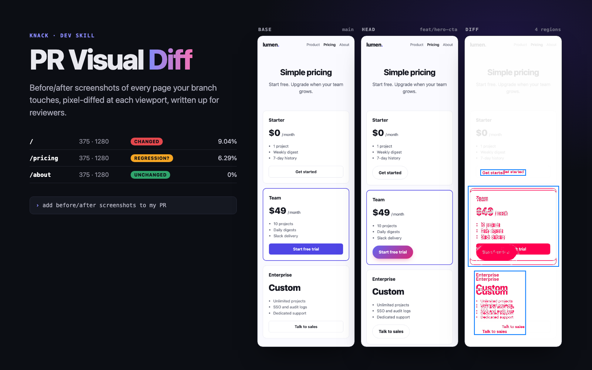

# PR Visual Diff

> Before/after screenshots and pixel diffs for every frontend PR, so reviewers see what changed and catch what broke.



Code review is blind to how a frontend change *looks*. A one-line CSS edit can restyle
the button you meant to change and quietly break three pages you didn't. This skill lets
your agent show reviewers the difference: it screenshots the affected pages on the base
branch and on your branch, pixel-diffs them at mobile and desktop widths, looks at the
results, and writes a "Visual changes" section for the PR that separates what you meant
to change from what might be a regression.

## What it does

1. **Finds the pages to check.** Maps changed files to routes for Next.js (app and pages
   router), Remix / React Router, SvelteKit, Nuxt, Astro, plain HTML and React Router
   SPAs, following imports from changed components and stylesheets up to the pages that
   use them.
2. **Brings up the "before" build** in a temporary git worktree on its own port, with
   dependencies installed by your lockfile's package manager. Your working tree is never
   touched.
3. **Captures and diffs** each page × width with Playwright and pixelmatch, after
   stabilizing: a virtual clock that freezes JS timers and animation frames identically on
   both sides, seeded randomness, frozen video/GIFs/animations, and waits for fonts,
   images and `aria-busy`. Unchanged pages diff at exactly 0 pixels on 116 of 120 tested
   pairs (tailwindcss.com, swiperjs.com, playwright.dev, animate.style, an Astro blog and a
   Next.js app), up from 13 of 32 live-site pairs differing before.
4. **Separates cause from cascade.** Rows that only moved are recognised by row alignment
   and shown as a blue band, so a taller hero is one red box plus "content below y≈482
   moved down 71px", not a wall of red. Removed and added blocks are named, faint colour
   tweaks below the visible threshold are flagged in amber, and `focus.png` shows each
   changed region side by side at up to 2x. Also reports size changes, new console errors
   and pages that start returning 404.
5. **Reviews the evidence.** The agent reads every close-up and compare image, describes
   the changes in plain words, and flags anything that looks unintended.
6. **Writes the PR section** with a table, close-ups and side-by-side images. Uploading
   images (gh `--attach`, an assets branch) or editing the PR only happens if you say yes.

## Try it

```text
add before/after screenshots to my PR
did my CSS refactor change anything visually?
visual diff this branch against main at 375, 768 and 1280
check /settings and /billing for visual regressions before I merge
```

## Requirements

- Node.js 18+ and git
- Chromium via Playwright (installed by `scripts/setup.sh`, ~150 MB once), or a local
  Chrome/Edge as fallback
- Your app's own toolchain (pnpm / yarn / npm / bun) to run the base build
- Optional: `gh` CLI if you want the agent to update the PR for you

```bash
bash scripts/setup.sh
```

## Examples

[`examples/`](examples/) holds three worked examples, each a real `capture.mjs` run on a
fictional fixture, with the images and `summary.md` excerpts listed in
[`examples/examples.json`](examples/examples.json) (selected images in `examples/output/`):

- **[`hero-cta-regression`](examples/output/hero-cta-regression/)** (`before/` → `after/`):
  an intended CTA restyle, plus a regression it causes on `/pricing` that `focus.png` makes obvious.
- **[`theme-token-refresh`](examples/output/theme-token-refresh/)** (`theme-tokens/`): a
  gray → slate token change too faint to see by eye, reported as `minor` with the colour pair
  named (`#e5e7eb → #e2e8f0`). The sign-in page correctly stays at 0 pixels.
- **[`banner-replaces-checklist`](examples/output/banner-replaces-checklist/)** (`layout-shift/`):
  a banner added and a card removed. The diff reports "50px-tall block added" and "303px of
  content removed" and shows the rest of the page as a blue moved band, not a regression.

## Run the example

`examples/` holds two versions of a tiny static site. The "after" version is a PR called
*Restyle hero CTA*: the hero button becomes a gradient pill (intended), but the same
stylesheet change drops the rule that made pricing-card buttons full width (unintended),
and the longer CTA pushes the secondary button onto a new line on mobile.

```bash
node scripts/capture.mjs --base examples/before --head examples/after \
  --pages /,/pricing,/about --full-page \
  --label-base main --label-head feat/hero-cta
```

Output in `./.knack/pr-visual-diff/`:

```
summary.md   summary.json
pages/home/375/{base,head,diff,compare,focus}.png
pages/home/1280/...   pages/pricing/375/...   pages/pricing/1280/...   pages/about/...
```

`summary.md` starts like this:

| Page | Width | Result | Pixels changed | Notes |
|---|---:|---|---:|---|
| `/` | 375px | **changed** | 3.08% (5.98% moved) | height 969 → 1039px; 2 changed regions; content from y≈482px moved down 71px |
| `/` | 1280px | **changed** | 0.99% (0.85% moved) | 1 changed region; content from y≈406px moved down 7px |
| `/pricing` | 375px | **changed** | 3.02% (3.53% moved) | height 1249 → 1271px; 3 changed regions; content from y≈555px moved down 7px; content from y≈886px moved down 16px |
| `/pricing` | 1280px | **changed** | 1.23% (0.20% moved) | 3 changed regions; content from y≈576px moved down 7px |
| `/about` | 375px | unchanged | 0% |  |
| `/about` | 1280px | unchanged | 0% |  |

…followed by, per changed pair, `focus.png` (the changed regions, base vs head, zoomed)
and `compare.png` (base | head | diff). The pricing close-up shows the regression at a
glance: the plan buttons lost their full width. Numbers vary slightly by OS font rendering.

## Scripts

| Script | Purpose |
|---|---|
| `affected-pages.mjs` | Changed files → candidate routes with confidence and reasons |
| `worktree-serve.mjs` | `start` base in a temp worktree, `serve` head, `list`, `stop --all` |
| `capture.mjs` | Screenshots, diffs, compare images, `summary.md` / `summary.json` |
| `publish-assets.mjs` | Optional: print the `gh --attach` upload command, or host images on an orphan branch (dry run unless `--push`) |

All support `--help`.

## Limitations

- Base and head must render the same data. If they talk to different databases, diffs
  show data, not UI. Mask data regions or point both at the same backend.
- Logged-in pages need a Playwright storage-state file that you create by logging in
  yourself (`npx playwright codegen --save-storage=auth.json <url>`).
- Route detection is heuristic. Config-based routers and workspace packages need you
  (or the agent) to pick pages by hand; dynamic routes need real parameter values.
- Getting images into the PR: drag and drop (works everywhere), `gh pr comment --attach`
  (gh 2.99+, push access, github.com only), an assets branch, or your existing CI artifact
  hosting. See `references/pr-images.md`.
- Determinism covers timers, `requestAnimationFrame`, `Date`, `Math.random`, CSS and JS Web
  Animations, video, GIFs and SMIL. Widgets driven by something else (one demo on
  tailwindcss.com in our tests), canvas/WebGL and third-party embeds can still differ:
  mask them. See `references/stabilization.md` for the measured flake rates.
- Chromium only. Safari/Firefox rendering differences are out of scope.
