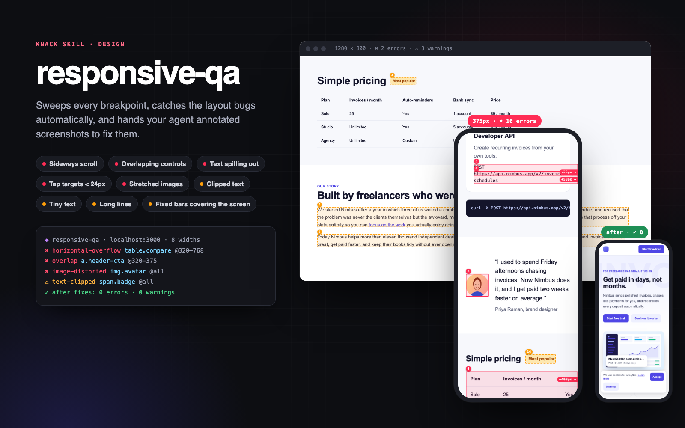

# Responsive QA

> Your agent can't see the page it just built. This skill gives it eyes at every breakpoint.



The most common complaint about AI-built UIs: it looks fine at the one width the agent imagined, then the page scrolls sideways on an iPhone, the header CTA sits on top of the logo, a long URL bursts out of a card, and the cookie banner covers half the screen.

`responsive-qa` opens the page in a real Chromium at 8 widths (320 → 1920). It measures the live DOM for those bugs and outlines each one on a screenshot. Then it hands the agent a contact sheet, a JSON report and the exact element to blame, and the agent fixes the root cause and re-runs until the report is clean.

## What it catches

| Check | Example |
|---|---|
| Horizontal scroll | A 760px table makes the whole page scroll sideways. The tool names `table.compare` and hints "hard-coded width". Also: `1fr` grid tracks blown open by a long email, flex children stuck at `min-width: auto`, `<pre>` blocks without a scroll box, ribbons with `right: -16px`, and `width: 100vw` bands (desktop widths emulate a 15px Windows scrollbar, so they show up) |
| Images too wide / distorted | A `width="640"` hero image cropped on phones; a 4:3 avatar squashed into a circle |
| Text spilling or clipped | Unbreakable URL leaving its card; badge text cut off with no ellipsis; white hero text wrapping below a fixed-height photo onto the white page (contrast-checked) |
| Overlaps | An absolutely positioned CTA covering the logo (checked against real paint order, so layered designs don't false-alarm) |
| Tap targets | Under 24×24px with WCAG 2.5.8's 24px spacing circle hitting a neighbour (error); under 44×44px (AAA / Apple HIG) is listed as info |
| Readability | Text under 12px on phones; paragraphs over ~90 characters per line on desktop |
| Screen hogs | Fixed/sticky banners covering > 30% of a phone screen; a fixed 460px modal cut off on a 375px phone |
| Anchor jumps | `#pricing` links landing the heading under a sticky header (no `scroll-padding-top`) |
| Viewport meta | Missing `width=device-width`, or zoom disabled |

It stays quiet about things that are fine: horizontally scrolling carousels and code blocks, `text-overflow: ellipsis`, `line-clamp`, `.sr-only` and off-page skip links, collapsed accordions, decorative `aria-hidden` / `alt=""` art bleeding off the edge, images cropped inside cards, off-canvas drawers, floating labels inside their inputs, rotated ribbons, stacked sticky cards, scaled-down product mocks, content scrolling under a sticky header, links inside sentences, and text hidden under opaque layers.

Precision is measured, not assumed. On stripe.com, github.com, tailwindcss.com, gov.uk, linear.app and vercel.com it reports **0 errors**; each earlier false positive was checked on the screenshot and fixed. It still finds every planted bug in the bundled fixtures, and the real bugs in the W3C "BAD" demo page.

## Example prompts

- "Check my landing page on mobile."
- "Why does my page scroll sideways on iPhone?"
- "The pricing page breaks on tablets, can you fix it?"
- "I just restyled the header, make sure it works at every breakpoint."
- "Run a responsive QA pass on /, /pricing and /blog before I ship."

## Requirements

- Node.js 18+
- Playwright 1.63.0 + Chromium. Run `bash scripts/setup.sh` once; it falls back to installed Chrome or Edge.
- A page to test: a local dev server URL (the skill can find a running one), any reachable URL, or a local `.html` file.

## Manual use

```bash
bash scripts/setup.sh
node scripts/detect-server.mjs                                   # which local servers are up?
node scripts/sweep.mjs http://localhost:3000 --full-page
node scripts/sweep.mjs http://localhost:3000 --pages /,/pricing --widths 360,390,768,1280
node scripts/sweep.mjs ./index.html --full-page --compare         # after a fix: what changed?
node scripts/sweep.mjs --help
```

Output (in `./.knack/responsive-qa/`):

- `contact-sheet.png`: grouped findings on top, then every viewport side by side with issues outlined and numbered
- `shots/<page>/<w>x<h>.png`: full-size annotated screenshot per viewport
- `shots/<page>/<w>x<h>-jump-<id>.png`: for `anchor-hidden`, the screen right after the jump, with the header and the hidden heading outlined
- `report.json`: machine-readable issues with selector, bounding box, element classes/text and cause hints, plus info items (44px targets, CLS) and notes (screenshot cap, infinite scroll)
- `report.prev.json`: the previous run, used by `--compare`

Exit codes are CI-friendly: `0` clean, `2` issues at or above `--fail-on` (default `error`), `1` tool error.

## Sample output

```
◆ responsive-qa · file:///…/examples/broken-page.html · 8 widths (320, 375, 414, 768, 1024, 1280, 1440, 1920) · full page
   320×568   ✖ 11  ⚠ 3  scrolls sideways +464px
   375×812   ✖ 9  ⚠ 4  scrolls sideways +409px
   …
  1920×1080  ✖ 2  ⚠ 3

✖ 42 errors  ⚠ 24 warnings  18 info · 8 viewports · 13.1s
  ✖ image-distorted     img.avatar          @all        Image is squashed: shown at 72×72 (1.00:1) but its natural ratio is 1.33:1. …
  ✖ tap-target          4× div.social > a   @320–768    Tap target “Nimbus on X” is 18×18px, below the 24×24px WCAG 2.2 AA minimum, and crowded …
  ✖ horizontal-overflow table.compare       @320–768    Runs 464px past the 320px viewport; the page scrolls sideways.
      ↳ table wider than the screen: wrap it in an overflow-x: auto container · same 760px width at every failing viewport → …
  ✖ image-overflow      img.hero-shot       @320–414    Image is 640px wide, wider than the 320px viewport; cropped by overflow on section.hero, 54% of it is cut off.
  ✖ overlap             a.header-cta        @320–375    Control “Start free trial” overlaps control “Nimbus Invoicing” (72×32px).
  ✖ fixed-cover         div.cookie          @320        Fixed element “Cookie preferences” covers 57% of the 320×568 screen.
  ⚠ text-clipped        span.badge          @all        Text “Most popular with studios” is truncated: 75px cut off horizontally …
  …
◆ Contact sheet → .knack/responsive-qa/contact-sheet.png
```

After the fixes (`examples/fixed-page.html`): `✓ No errors  no warnings`.

## Try it

`examples/broken-page.html` is a small landing page with one planted bug per detector, each marked `BUG n` in the source. `examples/fixed-page.html` is the same page fixed with fluid CSS (`FIX n`). `examples/fixtures/` adds three AI-style pages with planted bugs (a dashboard, a blog post, a landing page) and `clean-tricky.html`, a page of deliberate patterns that must produce zero findings:

```bash
node scripts/sweep.mjs examples/broken-page.html --full-page   # 11 bugs found
node scripts/sweep.mjs examples/fixed-page.html --full-page    # 0 errors, 0 warnings
node scripts/selftest.mjs                                      # every fixture: planted bugs found, clean pages clean
```

## Examples

Three worked examples in [`examples/`](examples/), each one real `sweep.mjs` runs on a bundled page with cropped evidence in [`examples/output/`](examples/output/) (manifest: [`examples/examples.json`](examples/examples.json)):

- **Landing page** (`broken-page.html` → `fixed-page.html`): 11 classic phone bugs found with their culprits. 42 errors / 24 warnings → 0 / 0, with `--compare` reporting 66 fixed.
- **Orders dashboard** (`dashboard/broken.html` → `shell-fixed.html` → `fixed.html`): a `232px 1fr` app shell stretched by a wide table. The first run blames `main`, suggests `minmax(0, 1fr)` and already lists the three culprits inside it (table, filter chips, KPI grid) by letting `main` shrink for a moment. The second run confirms them, and the third run is clean.
- **Blog post** (`fixtures/blog.html` → `blog/fixed.html`): a runaway `<pre>`, a 720px diagram, TOC anchors landing under a fixed header, and a `100vw` band that only breaks with a classic scrollbar. 24 errors → 0.

## Limits

Chromium only, emulated widths at 1× scale. It doesn't cover Safari-specific rendering, browser chrome or safe areas. It tests the page as loaded (no hover, open menus or modals) and needs a URL that works without login. The checks are tuned heuristics; `--ignore`, `--skip` and `data-responsive-qa="ignore"` handle the rest. See `references/fix-patterns.md` for fixes and false-positive guidance.

## License

MIT
