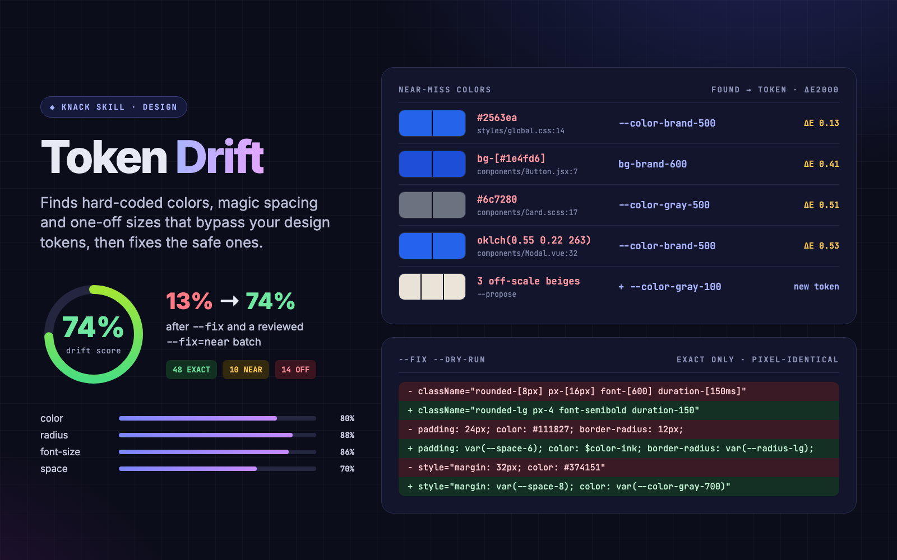

# Token Drift

> Finds hard-coded colors and spacing that bypass your design tokens, maps each to the right token, and fixes the safe ones.

Design systems rot quietly. A `#2563ea` here, a `padding: 15px` there, `p-[13px]` in a hurry, and six months later "brand blue" exists in nine shades. Coding agents make it faster: they read your token file and then paste the hex anyway. Most design-token tools *generate* tokens. **Token Drift audits them.** It finds every raw color, spacing, font size, radius, shadow, z-index and duration that bypasses your tokens, tells you which token it should have been, and rewrites the safe ones for you.



## What it does

- **Finds your tokens automatically.** It reads CSS custom properties in root and theme scopes (light, dark and other themes, including CSS variables defined in SCSS mixins that are `@include`d at the root), Tailwind v4 `@theme`, Tailwind v3 `tailwind.config.*` with its presets (read statically by default, never executed), W3C DTCG / Style Dictionary JSON, and SCSS / LESS variables. shadcn-style channel variables (`--primary: 222 47% 11%` used as `hsl(var(--primary))`) and `calc(var(--radius) - 2px)` values are resolved to real colors and pixels.
- **Understands monorepos.** Each token remembers its workspace package. A file only matches tokens its package can actually see (its own, an ancestor's, a workspace dependency's, or those of the app that renders it), with the Tailwind major version of that package, and a Tailwind class only counts as available if the CSS entry compiling that code includes the `@theme` defining it.
- **Scans the code** in `.css .scss .less .js .jsx .ts .tsx .vue .svelte .astro .html`: declarations, `<style>` blocks, styled-components templates, Tailwind arbitrary values (`p-[13px]`, `text-[#333]`), JSX `style={{ padding: 13 }}` and inline `style=""` attributes. It respects `.gitignore` and skips comments, tests, stories, generated files (compiled Tailwind output), JS palette/theme objects, token definitions, `@font-face` descriptors, transition delays and lines marked `token-drift-ignore` or `stylelint-disable-line`.
- **Matches each value to the nearest token.** Colors use CIEDE2000 (plus OKLab distance), sizes use px and percent. Each value is classified:
  - **EXACT**: equals a token. Swap it in.
  - **NEAR**: within threshold. Almost certainly drift.
  - **OFF-SCALE**: far from everything, or midway between two steps. Add a token or accept it as a one-off.
- **Scores it.** The drift score is the % of design values that already use tokens, broken down by category and file. Categories the project has no tokens for, colors in plain JS strings (canvas, charts, data) and files that can't use CSS variables (emails, OG images, React Native) are listed but not scored. `--fail-under 90` turns it into a CI guard.
- **Fixes conservatively.** `--fix` rewrites only EXACT matches, using the reference each file type needs: `var(--x)` in CSS, `$x` in SCSS (or `ns.$x` when the file `@use`s it with a namespace), a canonical class like `p-4` for Tailwind, `'var(--x)'` in JSX. `--dry-run` shows the unified diff first. It leaves alone anything where the swap could change rendering or meaning: Sass arithmetic, values computed in JS, `text-[14px]` → `text-sm` without a pinned line height, tokens from another package or another theme scope, named z-index layers, and a border token pasted into a background. NEAR fixes are opt-in (`--fix=near`) and meant for batch review.
- **Proposes tokens.** `--propose` clusters off-scale leftovers (say, 13 near-identical grays) into a minimal set of new tokens, or bootstraps a whole token set when you don't have one.

It has no dependencies (plain Node 18+) and makes no network calls. On a 4,400-file monorepo (cal.com) a full scan takes about 1.5 s and 130 MB.

## Example prompts

- "Find hardcoded colors that should use our tokens"
- "Audit design system drift in this repo"
- "How consistent is our spacing?"
- "Replace the hex values in src/components with our CSS variables"
- "Clean up the Tailwind arbitrary values like `p-[13px]`"
- "We don't have tokens yet. Suggest a palette and spacing scale from what the code already uses"
- "Add a CI check so nobody adds new magic numbers"

## Sample output

Run on the bundled fixture (`examples/acme-dashboard`):

```text
token-drift · acme-dashboard/  8 files scanned · 380 tokens from 4 sources

  Drift score   13%  ███░░░░░░░░░░░░░░░░░░░░░  11 of 83 design values use tokens

  EXACT       48  equals a token → swap in the token (41 auto-fixable)
  NEAR        10  within threshold of a token → likely drift (9 fixable with --fix=near)
  OFF-SCALE   14  far from every token → new token or deliberate one-off

  By category            tokens  exact  near   off  score
    color                      6     14     6     4    20%
    space                      4     13     1     5    17%
    radius                     1      6     0     1    13%
    ...

  Not auto-fixable (EXACT/NEAR that need a human)
        2  <token> is a named layer; use it only if this element belongs to that layer
        2  value computed in JS; review by hand
        1  text-sm also sets line-height; add a leading-* class or rewrite by hand

  Near misses (first 6)
    src/components/Button.jsx:7  hover:bg-[#1e4fd6] → hover:bg-brand-600  ΔE 0.41
    src/components/Card.scss:17  #6c7280 → var(--color-gray-500)  ΔE 0.51
    src/components/Modal.vue:32  oklch(0.55 0.22 263) → var(--color-brand-500)  ΔE 0.53
```

`--fix --dry-run` shows exactly what would change:

```diff
-    'inline-flex items-center gap-2 rounded-[8px] px-[16px] py-[10px] text-[14px] font-[600] transition duration-[150ms]';
+    'inline-flex items-center gap-2 rounded-lg px-4 py-2.5 text-[14px] font-semibold transition duration-150';
-      <span style={{ fontSize: 12, color: '#6b7280', letterSpacing: 0.4 }}>{label}</span>
+      <span style={{ fontSize: 'var(--font-size-xs)', color: 'var(--color-gray-500)', letterSpacing: 0.4 }}>{label}</span>
-  padding: 15px 24px;
+  padding: 15px var(--space-6);
```

(`text-[14px]` stays: `text-sm` would also set a line height that the original doesn't.) Applying `--fix`, then `--fix=near`, takes the fixture from **13% → 63% → 74%**. The rest is off-scale values and cases that need a human: a negative margin, named z-index layers, a color chosen by a JS ternary, canvas chart colors. Every rewritten file still parses (TypeScript, Sass, PostCSS, Vue), and every rewritten Tailwind class compiles in Tailwind 3.4.

## How it was tested

The scanner was benchmarked on six open-source codebases with real token systems: shadcn-ui (Tailwind v4 + CSS variables), cal.com and documenso (Tailwind v3/v4 monorepos with shadcn-style channel variables and presets), Mastodon (CSS variables defined in SCSS mixins), Excalidraw (SCSS + theme-scoped variables) and Primer React (with `@primer/primitives` passed via `--tokens`). On hand-judged random samples of findings, precision went from about 39% to over 95%, and `--fix` / `--fix=near` on copies of all six produced zero parse errors, zero Sass compile regressions, zero invalid Tailwind classes, and no unflagged value changes in Tailwind rewrites (each old/new class pair was compiled and compared). Fixes whose token changes per theme are listed for confirmation.

## Try it

```bash
node skills/token-drift/scripts/tokens.mjs skills/token-drift/examples/acme-dashboard
node skills/token-drift/scripts/scan.mjs   skills/token-drift/examples/acme-dashboard
node skills/token-drift/scripts/scan.mjs   skills/token-drift/examples/acme-dashboard --fix --dry-run
node skills/token-drift/scripts/scan.mjs   skills/token-drift/examples/acme-dashboard --propose
```

Reports land in `./.knack/token-drift/` (`report.md` with color swatches, a "What to do next" checklist and grouped tables, `report.json`, `fix.diff`, `proposed-tokens.css`).

The fixture has planted drift in five flavors: near-miss hex colors, `15px` vs a `16px` token, Tailwind arbitrary values, JSX inline styles and an `oklch()` near-match. It also includes traps the scanner must ignore: comments, SVG path data, a commented-out `<div>`, and JSX text with apostrophes.

## Examples

Three worked examples in [`examples/`](examples/), each a real run of `tokens.mjs` / `scan.mjs` on a bundled fixture, with rendered report sections and terminal excerpts in [`examples/output/`](examples/output/) (manifest: [`examples/examples.json`](examples/examples.json)):

- **Tailwind v3 dashboard** (`acme-dashboard/`): Tailwind config, CSS variables and SCSS. 48 EXACT, 10 NEAR, 14 OFF-SCALE. `--fix` rewrites 41 values (13% → 63%) and lists the 3 that will now follow dark mode. `--fix=near` takes it to 74%.
- **Tailwind v4 + shadcn-style tokens** (`nimbus-notes/`): `@theme inline` over light/dark CSS variables, with components full of `p-[13px]`, `text-[#0a0a0a]` and `bg-[oklch(…)]`. 49 safe fixes to semantic classes (18% → 85%), 15 of them flagged as theme-aware. Midway values like `p-[13px]` are left for a human.
- **No tokens yet** (`crumb-orders/`): CSS modules and styled-components with 119 hard-coded values. `--propose` clusters them into a starter set (`#333333`/`#323232`/`#343434` → one gray). Values used once are listed as one-offs rather than turned into tokens; adopting the 25 proposed tokens lets `--fix` take the score from 0% to 74%.

## Limitations

- Static analysis only. Values computed at runtime (`padding: ${size * 4}px`, `cn(isBig ? 'p-[13px]' : …)` built from variables) aren't followed, and values chosen by JS expressions are reported but never rewritten.
- Tokens that live in an npm package (e.g. `@primer/primitives`) aren't discovered from `node_modules`; pass the package's CSS or JSON folder with `--tokens`.
- SCSS maps (`map-get($spacers, 3)`), the `font` shorthand, `line-height`, `letter-spacing` and width/height aren't audited.
- Style objects outside `style={{ }}` (e.g. `const styles = { padding: 13 }`, React Native `StyleSheet.create`) aren't scanned as styles.
- Package visibility comes from `package.json` dependencies and stylesheet `@import`s. Undeclared cross-package CSS (a global stylesheet loaded by a `<link>` tag) can hide a token from a package that does see it at runtime.
- Numbers inside `calc()` expressions that also contain `var()` are still compared to the scale, though they're often arithmetic constants.
- Palette classes used *instead of* semantic tokens (`bg-red-500` where the system has `bg-destructive`) aren't flagged; Token Drift looks at raw values, not at which token was picked.
- It doesn't render the page, so NEAR fixes are imperceptible by threshold, not verified pixel by pixel.

See [`references/token-sources.md`](references/token-sources.md) for supported formats and [`references/fix-policy.md`](references/fix-policy.md) for exactly what gets auto-fixed and why.
